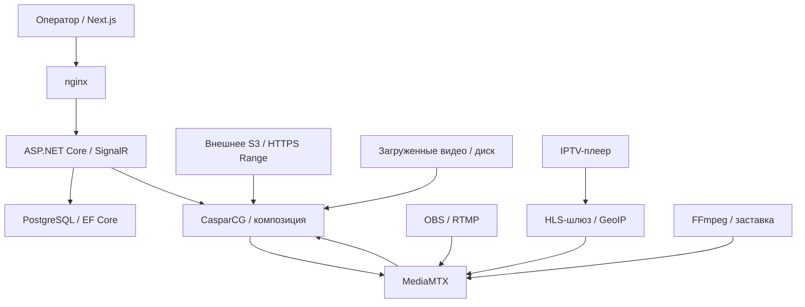

# Архитектура LUMIÈRE

## Управление и видеотракт

Модульный монолит ASP.NET Core хранит конфигурацию в PostgreSQL и управляет CasparCG по TCP AMCP. Работает один экземпляр API и его фоновых служб. Next.js обращается к API через nginx в том же origin; состояние обновляется через SignalR с опросом каждые 5 секунд в качестве резерва.

CasparCG получает два канала на один телеканал: `2 × slot − 1` — Program, `2 × slot` — Preview. Слой 10 — видео, слой 20 — графика. В конфигурации восемь каналов движка, поэтому MVP ограничен четырьмя телеканалами. Потребитель 100 каждого канала публикует H.264/AAC в MediaMTX. Сам MediaMTX не микширует графику и не выполняет монтаж.

Preview проигрывает выбранный источник на отдельном канале CasparCG. TAKE заново запускает этот источник в Program; синхронного переноса текущей позиции Preview в MVP нет. CUT мгновенно заменяет видеослой, MIX выполняет переход в кадрах. Графика остаётся отдельным слоем.

## Состояние и конкуренция

`Control` сериализует команды по телеканалу. Ручные действия содержат `revision`; устаревшее состояние даёт 409. Изменения состояния записываются после подтверждения AMCP. Подтверждение не доказывает наличие кадров: выход проверяется по API MediaMTX и в мониторе HLS. EF использует optimistic concurrency для канала. Создание каналов дополнительно защищено уникальными индексами slot/slug.

База и AMCP не образуют распределённую транзакцию: при потере БД после выполнения команды возможна временная рассинхронизация. Следующий этап — журнал намерений, подтверждение фактического состояния и восстановление без повторного TAKE. Несколько API/worker-реплик пока запускать нельзя.

## Автопилот

Цикл каждые 2 секунды выбирает активный непересекающийся блок в UTC. Позиция циклического плейлиста вычисляется из времени начала блока. Между блоками используется резерв. После перезапуска текущее воспроизведение восстанавливается по часам; используется seek. В MVP расчёт seek рассчитан на материалы 25 fps, поэтому импорт материалов другого fps требует предварительной нормализации для точной позиции.

После трёх отрицательных проверок входа OBS включается резерв. Ошибка API MediaMTX не считается доказательством пропадания OBS. В режиме автопилота восстановившийся OBS возвращается по расписанию; в ручном режиме возврат выполняет оператор. Потеря Program инициирует пересоздание потребителя и источника. Пустое расписание не останавливает эфир, если задан резерв.

Это управление с секундным разрешением, не аппаратный кадровый планировщик. Нагрузка, задержки HLS, интервалы GOP и формат входных файлов влияют на результат.

## Медиатека и S3

Локальная загрузка сохраняет файл под случайным именем, проверяет видео и длительность через FFprobe. CasparCG читает общий media-volume только для чтения.

S3 поддерживает HTTPS, path-style/virtual-hosted, ListObjectsV2 и AWS Signature V4. Конфигурация и секреты разделены; `IDataProtection` шифрует ключи до записи в БД. UI получает только endpoint, bucket, region и признак настройки.

Основной режим S3 — **прямое воспроизведение**. В БД хранится ключ объекта. Перед Preview/Program backend создаёт подписанный URL, который CasparCG читает напрямую с Range-запросами. На диск API файл не пишется. Длительность для расписания задаёт оператор. Ссылки подписываются на 7 дней, долго живущий Program переподключается через 6 дней. У временных STS-ключей фактический срок может быть короче; автоматического обновления STS в MVP нет.

Дополнительный импорт S3 — отдельное задание. Один worker потоково скачивает объект в `.part`, проверяет FFprobe, перемещает в media-volume и создаёт локальный источник. При перезапуске незавершённое задание начинается заново; HTTP Range-resume загрузки пока нет. Снимок задания содержит зашифрованные, а не открытые ключи.

API блокирует HTTP, перенаправления и подключения к внутренним/служебным IP при обращениях к S3. Адрес проверяется при реальном DNS-соединении, а не только при сохранении. Прямой CasparCG читает URL самостоятельно: изолируйте медиадвижок от служебных сетей, разрешив только нужные адреса MediaMTX и S3. Настройку хранилища выполняет доверенный оператор.

## Региональный шлюз

Каждый `/hls/program/{slug}/{file}` проверяет IP зрителя. Для запрещённого региона путь внутри MediaMTX заменяется на `slate/{slug}`. Проверка повторяется для сегментов, а не только master-playlist. Preview требует входа оператора. Внешние запросы к MediaMTX по RTMP не могут читать эфир: чтение требует внутреннего engine-пароля.

Заставку кодирует отдельный FFmpeg-процесс с тишиной. Все запрещённые зрители одного канала используют один поток заставки. Изображение можно загрузить отдельно для каждого канала. Изменение картинки перезапускает только поток заставки.

GeoIP Country определяет страны, City — страны и административные регионы. Неизвестный регион блокируется, если включено соответствующее правило. Отсутствующая/неисправная база не разрешает включить новую политику; ранее включённая политика закрывает доступ к основной программе. Пока поток заставки подготавливается, шлюз отвечает 503, а не раскрывает эфир.

nginx перезаписывает `X-Forwarded-For` адресом соединения. API доверяет только адресу gateway `172.29.80.10`; произвольные клиентские заголовки страны не используются. Шлюз отдаёт `private, no-store`; публичный кеш недопустим без отдельной авторизации.

## Источники протоколов

- https://casparcg.com/docs/wiki/protocols/amcp-protocol
- https://casparcg.com/docs/wiki/server/consumers/ffmpeg-consumer
- https://casparcg.com/docs/guides/linux-headless
- https://mediamtx.org/docs/features/control-api
- https://mediamtx.org/docs/references/configuration-file
- https://maxmind.github.io/GeoIP2-dotnet/
- https://docs.aws.amazon.com/AmazonS3/latest/API/API_ListObjectsV2.html
- https://docs.aws.amazon.com/AmazonS3/latest/API/sig-v4-header-based-auth.html
- https://docs.aws.amazon.com/AmazonS3/latest/API/sigv4-query-string-auth.html
